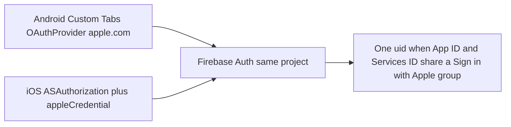

# Apple sign-in

Same Rust APIs on both platforms (`sign_in_with_apple` / `link_with_apple`). They live on the crate root and in `prelude`, same shape as Google: `Result<User, FirebaseError>`. Call them from `spawn_blocking` (or another worker thread). The system sheet presents on the main thread while the worker waits.

Enable Apple under Authentication in the Firebase Console. This crate does not take a Services ID, Team ID, Key ID, or private key. Those stay in the Console Apple provider. The crate does not embed `google-services.json` or an Apple private key.

Federated sign-in against the Auth emulator is not a supported Apple path. Keep email/emulator for CI and Maestro. Exercise live Apple on a real project with the demo (see [Manual demo](#manual-demo)).

## API

| Function | Behavior |
| --- | --- |
| `sign_in_with_apple()` | Presents Sign in with Apple and signs in (or creates) the Firebase session. |
| `link_with_apple()` | Links Apple to the **current** user. UID is unchanged on success. |
| `unlink("apple.com")` | Drops the Apple provider. This is the only way to detach Apple. There is no switch-account helper. |

`unlink("apple.com")` then `link_with_apple()` while still signed in attaches a different Apple identity to the same uid. Signing in with Apple after unlink (without linking) creates a **new** Firebase user.

Hosts pass Firebase top-level fields and every `provider_data` row through as-is. There is no Google/Apple email merge. An Apple private-relay address stays on the `apple.com` row; apps that want a preferred email read `provider_data` themselves.

## Wire codes

Failures return `FirebaseError::AuthException { code, message }`:

- `web-context-canceled` — Android user dismissed the Apple Custom Tab (Firebase’s code, same as FlutterFire on Android)
- `web-context-already-presented` — Android Custom Tab was torn down, often because the app Activity sets `android:taskAffinity=""`
- `canceled` — iOS user dismissed the Apple sheet (`ASAuthorizationError.canceled`; FlutterFire reports this as `canceled`). Google sheet dismiss uses the same code.
- `unavailable` — missing Activity (Android), or the Apple identity token / presentation failed (iOS)
- `no-current-user` — `link_with_apple` while signed out
- `operation-not-allowed` — a second iOS Apple sign-in or link while a sheet is already up
- `credential-already-in-use` / `account-exists-with-different-credential` — Firebase collision codes, passed through. The host does not sign in with an updated credential.
- `provider-already-linked` / `no-such-provider` — link or unlink of a provider that is already linked, or not linked

Desktop and web: `initialize_app` returns `UnsupportedPlatform`. Calling a primitive before `initialize_app` returns `NotInitialized`.

A `cargo` / `cross` test process is not the app process, so Android and iOS lib tests expect `HostMissing` for these calls. On-device flows need a `dx` build of the demo.

## Platforms

Dart `signInWithProvider(AppleAuthProvider())` is one API. The native plugins differ, and this crate follows each plugin.

### Android

The Kotlin host builds `OAuthProvider("apple.com")` with scopes `email` and `name`, then calls `startActivityForSignInWithProvider` or `startActivityForLinkWithProvider`. That is the web Services ID flow. A link finishes in `GenericIdpActivity` and can leave `currentUser` without `apple.com` in `providerData`, so the host reloads the user before it replies. A failed reload still returns the linked user. No extra Rust option is required beyond a configured Firebase project.

Apple only shares the user’s **name** (and sometimes email) with the app on the **first** authorization for that Services ID. Later Connect / sign-in calls return the same Firebase uid without a name. Firebase usually stores `displayName` on that first sign-in; the host also copies a name from `AdditionalUserInfo.profile` into the profile when Firebase left it blank. If the first Android Custom Tab auth never received a name (or you signed in before Firebase was configured), Apple will not send it again until the user revokes Sign in with Apple for the app (device Settings → Apple Account → Sign in with Apple → Stop Using) and Connects again as a fresh authorization. There is no Android API equivalent of iOS `appleCredential(…, fullName:)` for the Custom Tab flow.

This crate’s manifest does not set `android:taskAffinity`. The **app** Activity must not set `android:taskAffinity=""` either. That value closes the Custom Tab when the user leaves it (for example to a password manager) and Firebase returns `web-context-already-presented`.

### iOS

Firebase Auth 11.15 `OAuthProvider(providerID: "apple.com")` calls `fatalError` unless the Auth emulator is set. The message says to use the Apple SDK. FlutterFire’s iOS plugin does that: `ASAuthorizationAppleIDProvider`, scopes email and name, a SHA-256 nonce, then `OAuthProvider.appleCredential(withIDToken:rawNonce:fullName:)` and `signIn(with:)` / `link(with:)`. The Swift host does the same. That credential applies the first-sign-in name. A generic `signIn(with: provider)` call is not used. A second `sign_in_with_apple` or `link_with_apple` while that sheet is up returns `operation-not-allowed`.

The app’s provisioning profile must include the Sign in with Apple capability. A simulator `dx` build without `--codesign` only sees entitlements embedded in the Mach-O `__TEXT,__entitlements` section. The demo embeds `com.apple.developer.applesignin` = `Default` there for `target_abi = "sim"` ([`examples/demo-simulator.entitlements`](../examples/demo-simulator.entitlements)). Device builds are codesigned by `dx --device` and omit that section. This crate does not inject device entitlements; the capability belongs on the app profile. The placeholder team id `DEMOTEAMID` in the demo plist is not a real Apple Team ID.

## Cross-platform identity

One Apple ID is one Firebase uid in both directions (Android first, then iOS, and the reverse) when:

- Both apps use the **same** Firebase project, with the Apple provider enabled.
- The Apple Developer account groups the iOS App ID (bundle id) and the Services ID in one Sign in with Apple group, under the same Team.
- The Console Apple provider has the Team ID, Key ID, private key, and that Services ID.
- The Services ID return URL is `https://<project-id>.firebaseapp.com/__/auth/handler`.

Apple’s user identifier (`sub`) is scoped to the client. An ungrouped App ID and Services ID produce two different `sub` values and therefore two Firebase users. That is a Console / Apple Developer misconfiguration, not a host bug.

## Manual demo

Live project only (`FIREBASE_USE_AUTH_EMULATOR=0`). Maestro stays on email/emulator and does not drive the Apple tile. Serve with `make android-demo` or `make ios-demo` after the Console steps above.

1. Android: open the Apple tile, tap Connect to Apple. Status shows `Connected to Apple: <uid> (apple.com)`.
2. Sign out. On iOS, Connect to Apple with the same Apple ID. The uid matches step 1.
3. Reverse the order: iOS first, then Android, same Apple ID, same uid.
4. Email sign-up, then Connect to Apple. Account shows `apple.com` and `password`. Sign out. Connect to Apple on the other platform. The uid matches the email user.

Linking details: [Errors and linking](errors-and-linking.md).

## Not in this crate

FlutterFire returns `additionalUserInfo.authorizationCode` on iOS and exposes `revokeTokenWithAuthorizationCode` for Apple account deletion. This crate’s `User` wire has no authorization code and no revoke API. A missing code is that gap, not a failed sign-in.
